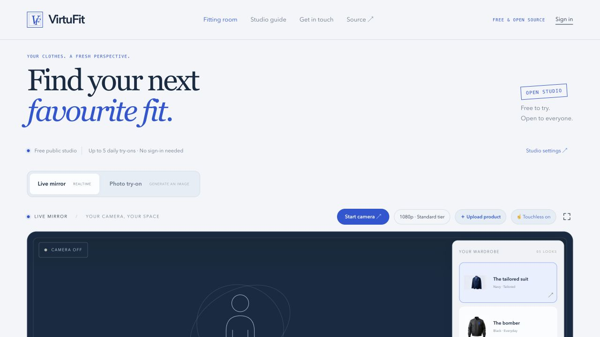

# VirtuFit

An open-source fitting studio: try clothes in a live webcam mirror or generate one finished try-on photo from a person photo and a garment reference.

**[Open the studio](https://www.virtufit.xyz) · [Studio guide](https://www.virtufit.xyz/docs) · [MIT license](LICENSE)**

Public try-on is free for visitors, funded by the owner's Decart account. It requires no sign-in, credit purchase or visitor API key. Daily and concurrent allowances protect the shared service. Self-hosting requires your own provider account and may incur provider charges.



## What you can do

- Live mirror with 1080p requested by default, optional 720p, snapshots, fullscreen and original-view comparison.
- Point with one finger and hold for one second to choose clothing. Hand tracking runs in a local worker with one frame in flight.
- Choose five sample garments or add your own via browse, drop or paste. Categories include tops, dresses, full outfits, bottoms and kurtas. Save a wardrobe in your browser.
- Photo try-on uses separate person and garment images, generates one 720p image, and offers a download. Switching to photo mode stops the camera.
- View real SDK frame rate, output size and camera-to-display delay when available. Network round-trip time is labelled separately.
- Use an optional account for account settings and previous records. Public try-on works signed out.

## Run locally

Use Node.js 24, npm and PostgreSQL. Clone this repository, then run:

```sh
npm ci
cp .env.example .env.local
```

Set DATABASE_URL, distinct random JWT_SECRET / JWT_ADMIN_SECRET values of at least 64 characters, and your private DECART_API_KEY in `.env.local`. On a **new, empty development database only**, initialize the existing schema with `npx prisma db push`. Existing production databases already have the schema; never reset or seed them as a release step.

```sh
npm run dev
```

Open http://localhost:3000. For a production build, run `npm run build` and `npm start`. Camera access requires HTTPS in production; localhost is supported for development.

Optional account email and existing developer integrations need their corresponding environment values. They are not required to use anonymous public try-on. Existing integration/billing records and authenticated API routes are retained for compatibility; the free studio uses its own allowance counters.

## Free access and payment switch

`PAYMENTS_ENABLED` defaults to **false**. With this setting, the server refuses new checkout creation, public try-on has no account or credit gate, and no purchase prompts appear in the public studio or account dashboard. The old billing webhook still verifies and handles legitimate pending callbacks. No subscriptions, historical payments or balances are cancelled, refunded or discarded.

The permanent Decart key belongs only in a server environment variable named `DECART_API_KEY`, never `NEXT_PUBLIC_*`. The browser gets only a short-lived token scoped to the exact site origin, try-on model and session duration. Photos go through a validated server route. No visitor key setup exists.

Default free allowances:

| Setting | Default |
| --- | --- |
| Per-browser requests per UTC day | 5 |
| Per-network requests per UTC day | 10 |
| Shared requests per UTC day | 50 |
| Shared active requests / sessions | 2 |
| Live session choices | 30 or 60 seconds |
| Token validity for new connections | 30 seconds |
| Shared internal allowance units | 100 per UTC day |

A live minute reserves 10 internal units (including potential faster-tier use), a half-minute 5 and a photo 2. Units are an owner-side cost-control estimate, **not money or visitor credits**. Attempts remain counted after cancellation and provider failure. A cookie reset cannot bypass the shared network limit. Visitors on the same network share that network allowance.

The existing PostgreSQL `AppSetting` table stores signed-cookie/network hashes, counts and temporary holds under a private `virtufit:free:v1:` namespace. A transaction lock serializes reservations across server instances. Counters older than seven days are removed; photos and raw IP addresses are not stored. A database or allowance failure stops the request before contacting the provider.

These controls limit requests issued by VirtuFit, not Decart's total monetary spend. Client tokens can be replayed during their short validity window; origin restrictions are browser-enforced. Set suitable spending and concurrency limits in your Decart account as well.

See [PRODUCTION.md](PRODUCTION.md) for deployment, limits, server configuration and rollback notes.

## Verify changes

```sh
npm run test:try-on
npm run build
npm audit --omit=dev
```

Tests cover hand selection, truthful video metrics, photo resizing/metadata removal, invalid uploads, origin checks, anonymous allowance limits and payment-off defaults. Paid video and image generation are not part of automated checks. Garment fidelity, actual video latency and physical pointing accuracy depend on the real camera, network, provider and input.

## Contribute

Keep VirtuFit one coherent platform: use the shared design tokens, navigation and components. Include meaningful checks for allowance or API changes. Never add credentials, environment files, personal photos or customer data to a pull request. Use mocks for provider tests unless the owner explicitly authorizes billed testing.

## License and attribution

Application code: [MIT](LICENSE). Retained code and assets: [third-party notices](THIRD_PARTY_NOTICES.md). Your deployment still needs its own provider credentials, service agreements and operating budget.
